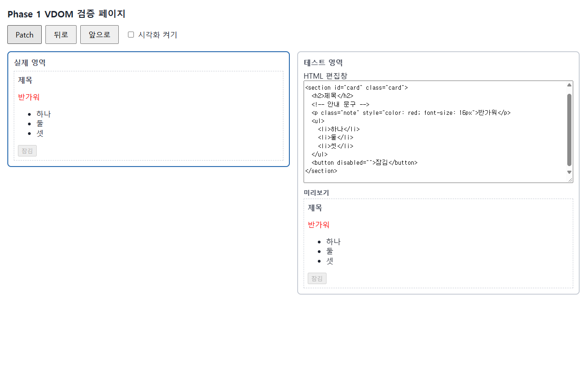
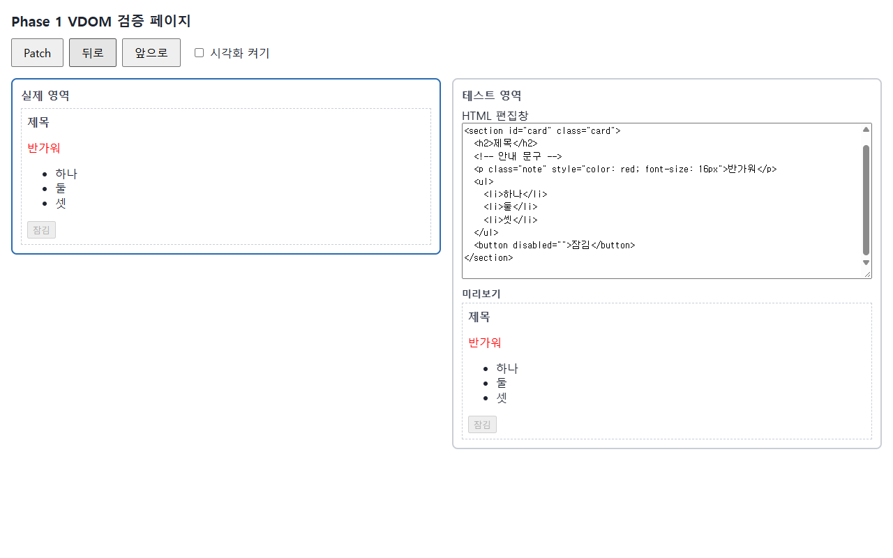
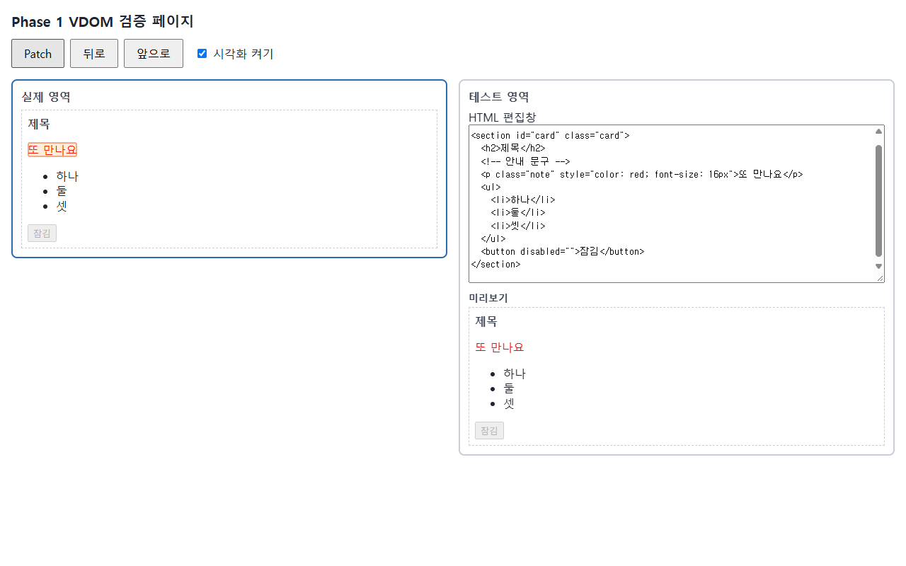
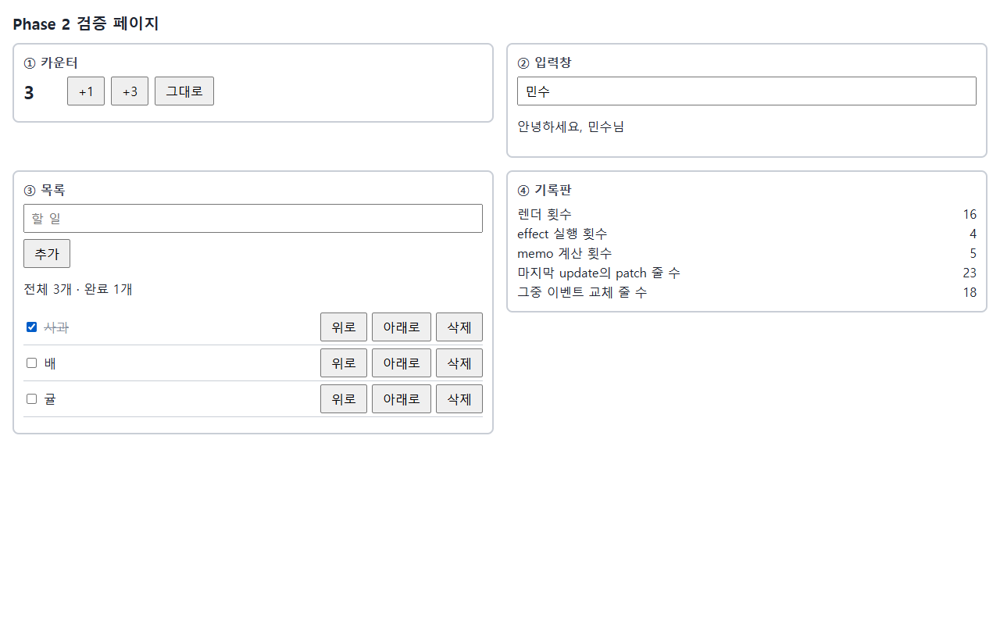
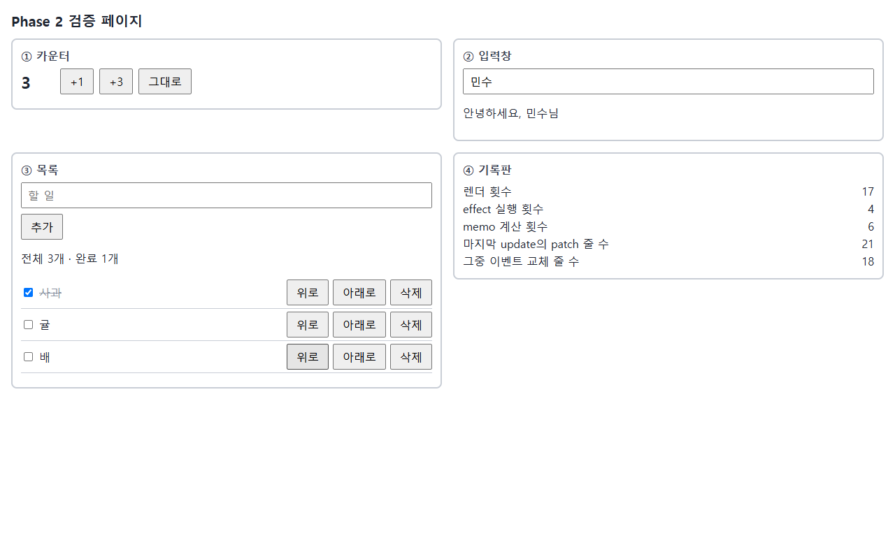

# mini-react

개인 미니 리액트 구현 (요구사항: `docs/PRD/요구사항 정의서 PRD.md` v2.1).

## 실행

- `npm ci` → `npx playwright install chromium`
- 단위 테스트: `npx vitest run` · 인수 테스트: `npx playwright test` · 개발 서버: `npm run dev`

<!-- mini-react-kit:readme:start -->
<!-- 이 표시 사이는 4단계에서 mr-wiki가 갱신한다. 표시 밖은 건드리지 않는다 -->

## 아키텍처 & 동작 흐름

- 패키지 역할: `shared`(타입) · `react`(`h()` · Hook API) · `react-reconciler`(`diff` · `FunctionComponent`) · `react-dom-bindings`(DOM 접근 유일) · `react-dom`(`render` · History) · `scheduler`(재렌더 예약)
- Phase 1: 테스트 영역 → VNode → `diff`(저장한 이전 VNode와 비교) → 패치 목록 → `patch`(실제 영역에 바뀐 곳만) → History 기록
- Phase 2: setter → 즉시 렌더(`App()` 재실행) → `diff` → `patch` → effect
- 자세히: [wiki/architecture.md](wiki/architecture.md)

## 핵심 구현 기능 & 동작 화면

| 기능 | 화면 |
| --- | --- |
| Patch: 글자 하나만 고쳐 반영, 나머지 노드는 그대로 |  |
| 뒤로 · 앞으로: 편집창 · 테스트 영역 · 실제 영역이 함께 이동 |  |
| Diff 시각화: 스위치를 켜면 바뀐 노드만 깜빡임 |  |
| Hooks 자동 갱신: 할 일 체크 · 완료 요약 · 기록판(렌더 · effect 횟수) |  |
| Key 이동: [위로] · [아래로]로 순서를 바꿔도 같은 항목(key) 유지 |  |

## 핵심 기술 포인트

- 변경 감지: 이전 · 새 VNode 비교 → 고칠 일 목록 → 목록대로 바뀐 곳만 DOM 반영 (위치 기반 필수 · key 확장 MOVE)
- 되돌리기: 기록마다 VNode · 패치 · 역패치 저장 (양방향 연결 리스트, 한도 50), 뒤로 = 역패치를 역순 적용
- Hooks · 재렌더 · 이벤트: `hooks` 배열에 부른 순서로 저장, `if` 안 Hook 금지, setter마다 즉시 동기 렌더 (Batching 미구현), 요소마다 리스너 한 번 + 핸들러 교체
- 실제 React와 차이: 고칠 목록 대신 노드마다 표시 · React에는 History 없음 · React는 setter를 모아 한 번에 렌더
- Reflow / Repaint와 VDOM (마스터 초안, 사용자 확인 대기):
  - 브라우저는 DOM이 바뀌면 스타일 계산 → **reflow**(위치 · 크기 다시 계산) → **repaint**(픽셀 다시 그리기)를 한다. 글자 · 크기가 바뀌면 reflow + repaint, 색만 바뀌면 repaint만 일어난다.
  - VDOM이 reflow를 없애 주지는 않는다. 우리 엔진이 하는 일은 ① diff로 **바뀐 곳만** 실제 DOM에 쓰고(텍스트 하나면 SET_TEXT 1줄), ② patch 도중 `offsetWidth` 같은 레이아웃 값을 **읽지 않아서** 브라우저가 JS가 끝난 뒤 reflow · repaint를 한 번에 하게 두는 것이다.
  - 즉시 동기 렌더라 [+3]은 렌더 · diff · patch가 3번 돌지만, 그리기는 클릭 처리 JS가 끝난 뒤 한 번이다. 비용이 늘어나는 곳은 JS(diff · patch) 쪽이다.
  - 그래서 VDOM이 항상 빠른 것은 아니다. 바뀔 곳을 미리 아는 직접 DOM 수정이 더 싸고, VDOM은 그 비교 비용을 내고 "바뀐 곳 찾기"를 자동으로 해 준다 (PRD §8.2 "Virtual DOM이 항상 빠르다는 결론을 전제로 두지 않는다"). 대시보드 M-07은 DOM 반영까지 시간이라 reflow · repaint 시간은 들어 있지 않다.

## AI 워크플로 운영 결과

| 항목 | 값 |
| --- | --- |
| task 수 · 검수 회차 | task 2개 · task_001 검수 2회 (둘 다 REJECT, 2회차 뒤 마스터 확인) · task_002 검수 3회 (개발 1회 APPROVE · 경량 2회: REJECT → APPROVE) |
| QA 실패 분류 (구현 · 테스트 · 명세) | QA 실패 0건 (두 task 모두) — 3갈래 분류 대상 없음. 개발 검수 BLOCKING 5건(task_001 4 · task_002 1)은 모두 작업자 재작업으로 해결 (`code_review_log.md`) |
| 자동 테스트 (최종) | task_001: vitest 432 · playwright 96 / task_002: vitest 776 · playwright 154 / tsc 오류 0 |
| 구현에 쓴 토큰량 | 아래 표 (`/usage` 전후 비교는 하지 않음) |

- 위키 · 상세 기록: [wiki/index.md](wiki/index.md) · [wiki/qna_prep.md](wiki/qna_prep.md)

### 구현에 쓴 토큰량

세션 · 서브에이전트 기록(`~/.claude/projects/…/<세션>.jsonl` · `subagents/*.jsonl`)의 `usage`를 메시지마다 한 번씩 더한 값. 구간은 각 task 타임라인의 시작 ~ 병합 시각(KST). 합계의 약 97%는 캐시 읽기(이미 읽은 맥락을 다시 쓰는 것)다.

| 구간 | 마스터 (Opus) | 작업자 (Sonnet) | 검수자 (Opus) | QA (Sonnet) | 위키 (Haiku) | 합계 | 그중 출력 |
| --- | --- | --- | --- | --- | --- | --- | --- |
| task_001 Phase 1 (11-10 18:39 ~ 11-11 04:28) | 8,701만 | 4,359만 | 177만 | 101만 | - | **1억 3,338만** | 70.3만 |
| task_002 Phase 2 (11-11 04:30 ~ 13:48) | 5,195만 | 5,283만 | 603만 | 78만 | - | **1억 1,160만** | 51.8만 |
| 4단계 위키 · README (13:49 ~ 14:10 무렵) | 약 860만 | - | - | - | 310만 | **약 1,212만** | 11.4만 |

<!-- mini-react-kit:readme:end -->
