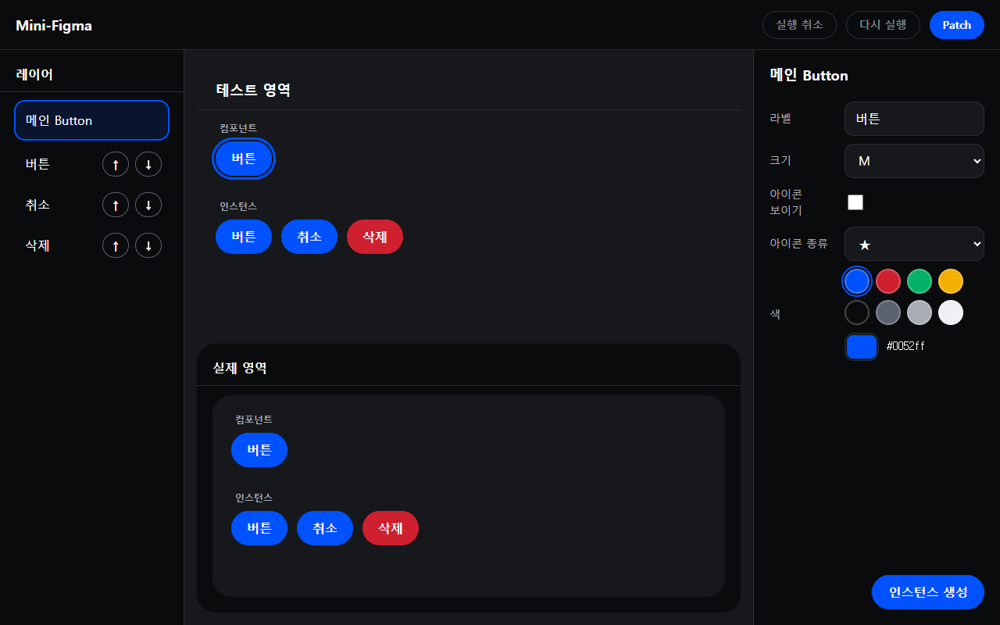
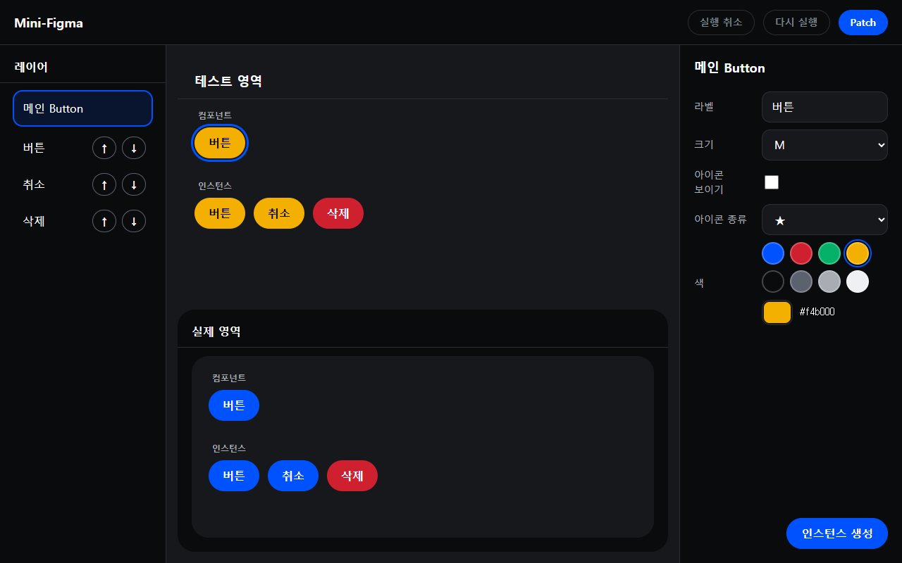
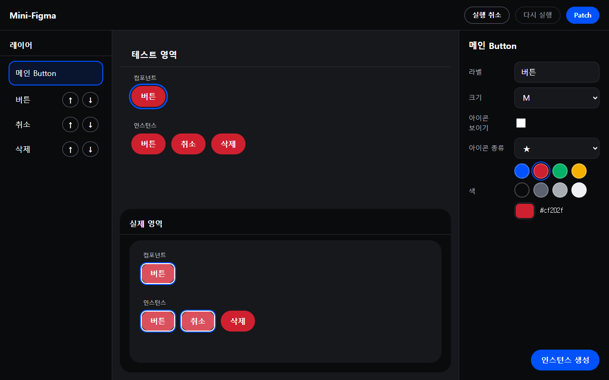
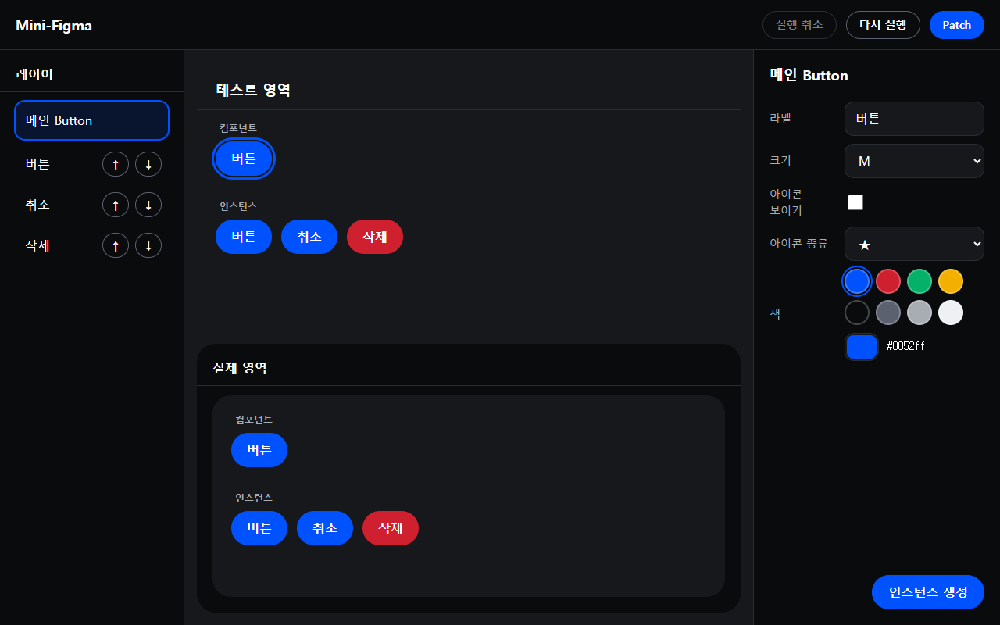
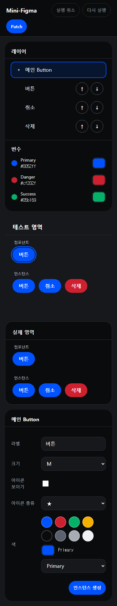
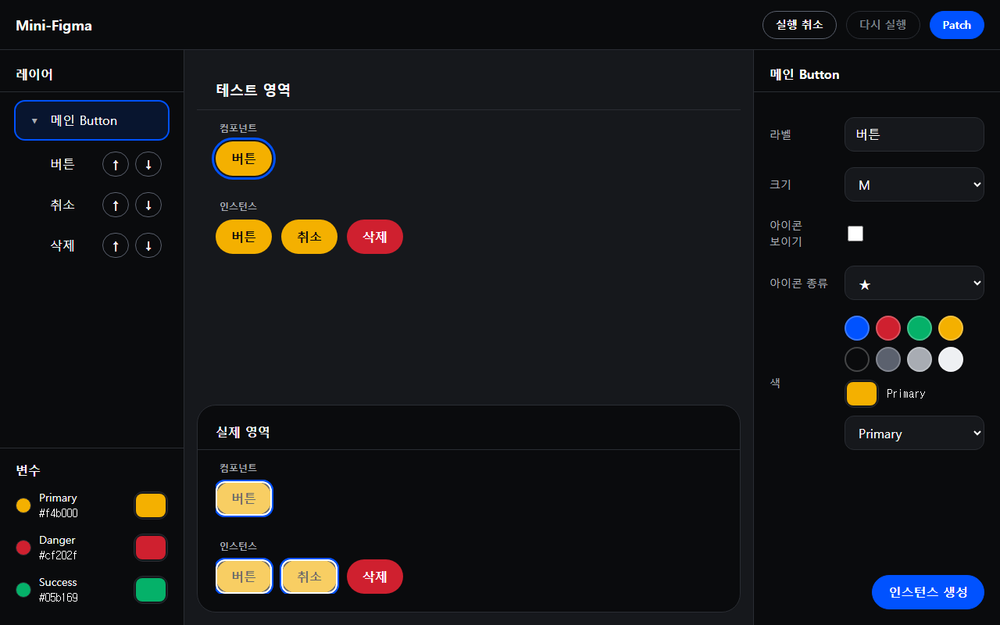
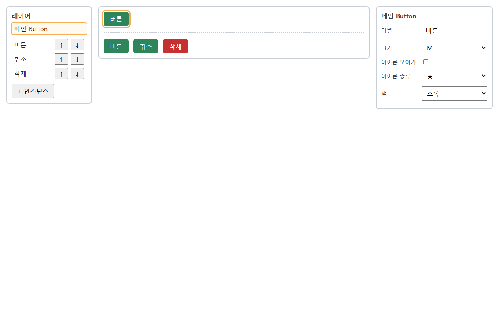
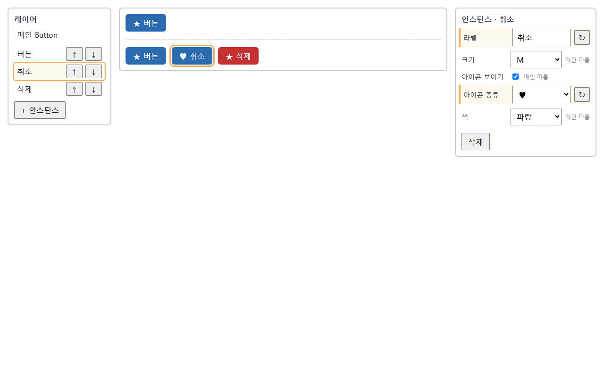
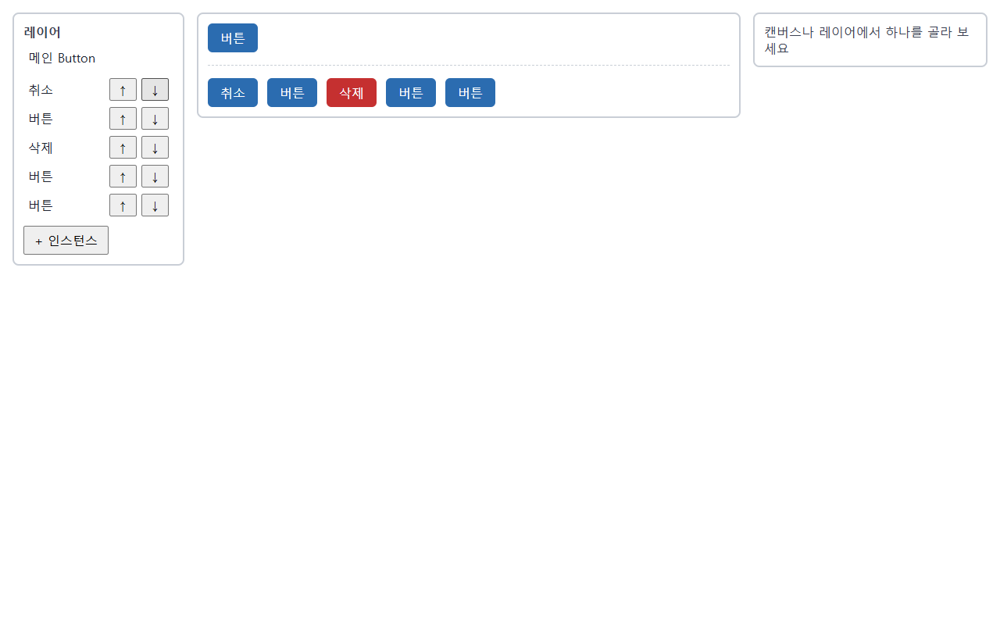
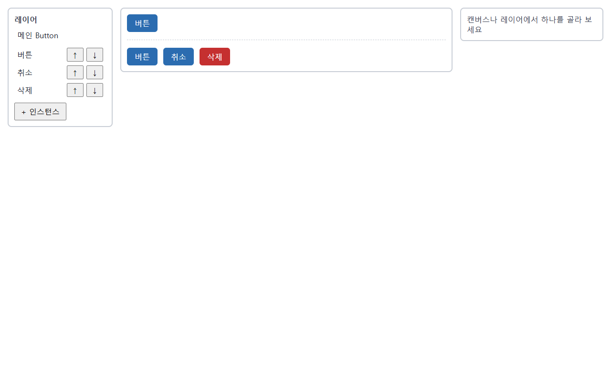

# mini-react

개인 미니 리액트 구현 (요구사항: `docs/PRD/요구사항 정의서 PRD.md` v2.1).

## 실행

- `npm ci` → `npx playwright install chromium`
- 단위 테스트: `npx vitest run` · 인수 테스트: `npx playwright test` · 개발 서버: `npm run dev`

<!-- mini-react-kit:readme:start -->
<!-- 이 표시 사이는 4단계에서 mr-wiki가 갱신한다. 표시 밖은 건드리지 않는다 -->

## 아키텍처 & 동작 흐름

- 패키지 역할: `shared`(타입) · `react`(`h()` · Hook API) · `react-reconciler`(`diff` · `FunctionComponent`) · `react-dom-bindings`(DOM 접근 유일) · `react-dom`(`render` · History) · `scheduler`(재렌더 예약)
- Phase 1: 테스트 영역 → VNode → `diff`(저장한 이전 VNode와 비교) → 패치 목록 → `patch`(실제 영역에 바뀐 곳만) → History 기록
- Phase 2: setter → 칸 값을 바로 바꾸고 렌더는 마이크로태스크로 한 번 예약 (Batching) → 렌더(`App()` 재실행) → `diff` → `patch` → effect
- 시연 앱 mini-figma: 엔진은 고치지 않고 `@mini-react/*`로 가져다 씀 (`fixtures/mini-figma/`). state는 `App` 하나(Hook 8칸), 자식은 props만 받음. 캔버스(테스트 영역) 아래 실제 영역은 [Patch]를 눌러야만 바뀜
- 자세히: [wiki/architecture.md](wiki/architecture.md)

## 핵심 구현 기능 & 동작 화면

| 기능 | 화면 |
| --- | --- |
| Patch: 글자 하나만 고쳐 반영, 나머지 노드는 그대로 |  |
| 뒤로 · 앞으로: 편집창 · 테스트 영역 · 실제 영역이 함께 이동 |  |
| Diff 시각화: 스위치를 켜면 바뀐 노드만 깜빡임 |  |
| Hooks 자동 갱신: 할 일 체크 · 완료 요약 · 기록판(렌더 · effect 횟수) |  |
| Key 이동: [위로] · [아래로]로 순서를 바꿔도 같은 항목(key) 유지 |  |
| mini-figma 디자인 (task_005, 캡처는 task_006 이후 화면): 팔레트 판(칩 8 + 직접 고르기) · 메인을 `#f4b000`으로 → 메인 · b1 · b2 노랑 + 먹색 글자, b3 빨강 그대로 |   |
| mini-figma 실제 영역 (task_006): [Patch] 직후 바뀐 노드만 깜빡임 |  |
| mini-figma 되돌리기 (task_006): [실행 취소] → 테스트 영역 · 실제 영역이 함께 이전 색으로 |  |
| mini-figma 변수 (task_007, 모바일): 연결 중에는 칩 선택 표시 없음, 「Primary」 표시 |  |
| mini-figma 변수 (task_007): Primary 값을 바꾸면 연결된 버튼만 바뀌고, 실제 영역은 Patch 뒤에 바뀜 |  |
| mini-figma (task_004 당시 화면): 메인 색을 초록으로 바꾸면 override가 없는 인스턴스만 따라 바뀜 (b3 빨강은 그대로) |  |
| mini-figma (task_004 당시 화면): 메인 아이콘을 켜도 override한 b2는 ♥ 그대로 (아이콘 ★ ★ ♥ ★) |  |
| mini-figma (task_004 당시 화면): 인스턴스 추가 · 레이어 창 순서 바꾸기 (레이어 · 캔버스 함께 바뀜) · b2 삭제 뒤 Ctrl+Z 복귀 (Ctrl+Z는 task_006에서 [실행 취소]로 바뀜) |   |

## 핵심 기술 포인트

- 변경 감지: 이전 · 새 VNode 비교 → 고칠 일 목록 → 목록대로 바뀐 곳만 DOM 반영 (위치 기반 필수 · key 확장 MOVE)
- 되돌리기: 기록마다 VNode · 패치 · 역패치 저장 (양방향 연결 리스트, 한도 50), 뒤로 = 역패치를 역순 적용. 시연 앱은 [실행 취소] · [다시 실행]이 실제 영역과 테스트 영역 `doc`을 같은 칸으로 함께 되돌림 (Patch 때 `doc` 사본 저장, DOM은 다시 읽지 않음)
- 변수: 버튼 색 칸에 `'var:<id>'` 이름을 저장하고 그릴 때 hex로 풀어 칠함 → 변수 값 하나를 바꾸면 연결된 버튼만 바뀌고 렌더는 1번
- 실제 영역: [Patch]를 누르면 테스트 영역 DOM을 `readAreaChildren`으로 읽어 정리한 뒤 Phase 1 `diff` · `patch`로 바뀐 곳만 반영 (보기 전용, 빈 상자에 엔진이 그림)
- Hooks · 재렌더 · 이벤트: `hooks` 배열에 부른 순서로 저장, `if` 안 Hook 금지, setter는 칸 값을 바로 바꾸고 렌더는 마이크로태스크로 컴포넌트당 한 번 모음 (Batching, 같은 핸들러의 setter 3번 = 렌더 1번), 요소마다 리스너 한 번 + 핸들러 교체
- 실제 React와 차이: 고칠 목록 대신 노드마다 표시 · React에는 History 없음 · 우리 Batching은 `queueMicrotask` 한 가지뿐 (우선순위 · 시간 분할 없음)
- Reflow / Repaint와 VDOM (마스터가 쓰고 사용자 확인, 2026-11-11):
  - 브라우저는 DOM이 바뀌면 스타일 계산 → **reflow**(위치 · 크기 다시 계산) → **repaint**(픽셀 다시 그리기)를 한다. 글자 · 크기가 바뀌면 reflow + repaint, 색만 바뀌면 repaint만 일어난다.
  - VDOM이 reflow를 없애 주지는 않는다. 우리 엔진이 하는 일은 ① diff로 **바뀐 곳만** 실제 DOM에 쓰고(텍스트 하나면 SET_TEXT 1줄), ② patch 도중 `offsetWidth` 같은 레이아웃 값을 **읽지 않아서** 브라우저가 JS가 끝난 뒤 reflow · repaint를 한 번에 하게 두는 것이다.
  - Batching이라 [+3]은 setter 3번을 모아 렌더 · diff · patch가 1번만 돌고(task_002 즉시 동기 때는 3번), 그리기는 클릭 처리 JS가 끝난 뒤 한 번이다. 비용이 생기는 곳은 JS(diff · patch) 쪽이다.
  - 그래서 VDOM이 항상 빠른 것은 아니다. 바뀔 곳을 미리 아는 직접 DOM 수정이 더 싸고, VDOM은 그 비교 비용을 내고 "바뀐 곳 찾기"를 자동으로 해 준다 (PRD §8.2 "Virtual DOM이 항상 빠르다는 결론을 전제로 두지 않는다"). 대시보드 M-07은 DOM 반영까지 시간이라 reflow · repaint 시간은 들어 있지 않다.

## 알려진 한계

- Windows Chromium의 Ctrl+Y는 앱 키가 아니라 막지 않아서, 라벨 글자 칸에서 브라우저 글자 되돌리기를 한 뒤 칸 밖에서 Ctrl+Y를 누르면 브라우저 Redo가 라벨 칸에 적용돼 일반 수정 한 단계로 기록될 수 있다 (task_006부터 앱 편집 Undo 기록이 없어 「기록에 섞이는」 문제는 해당 없음. Ctrl+Y는 `keys.ts`에 없어 앱 키가 아니고, State History 다시 실행은 Ctrl/Cmd+Shift+Z만 — 마스터 코드 확인 2026-11-12)
- 시연 앱(task_006): 「실행 취소 → 편집 없이 [Patch]」는 무변경이라 기록이 안 쌓이고, 처음 · 끝 칸에서 편집만 하고 Patch를 안 한 상태는 꺼진 버튼으로 버릴 수 없다
- 시연 앱(task_005): 낮은 desktop 높이(예 721 × 300)에서는 도구 막대 · 패널 일부가 잘릴 수 있다 (테스트 크기 1280 × 800 밖)
- 엔진 이벤트는 `click` · `input`뿐이라 끌기 · 크기 조절 · 확대·축소가 없다

## AI 워크플로 운영 결과

| 항목 | 값 |
| --- | --- |
| task 수 · 검수 회차 | task 7개 · task_001 검수 2회 (둘 다 REJECT, 2회차 뒤 마스터 확인) · task_002 검수 3회 (개발 1회 APPROVE · 경량 2회: REJECT → APPROVE) · task_003 검수 1회 (가벼운 모드, 기획 검수 생략 · 개발 1회 APPROVE) · task_004 검수 6회 (기본 모드, 기획 2회: REJECT → APPROVE · 개발 묶음 3개 4회: 묶음 1 · 2 APPROVE, 묶음 3 REJECT → APPROVE) · task_005 검수 2회 (가벼운 모드, 개발 1회 APPROVE(Dev-1 ~ 8) · 경량 Dev-9 1회 APPROVE) · task_006 검수 3회 (가벼운 모드, Dev-1 ~ 7 REJECT → 재작업 → APPROVE · Dev-8 APPROVE) · task_007 검수 1회 (가벼운 모드, APPROVE, NB 4 반영) |
| QA 실패 분류 (구현 · 테스트 · 명세) | QA 실패 0건 (task_001 ~ 007) — 3갈래 분류 대상 없음. 개발 검수 BLOCKING은 모두 작업자 재작업으로 해결: task_001 4 · task_002 1 · task_004 1 (묶음 3, Undo 키 겹침, Q18) · task_006 1 (`qa_todo.md`가 최신 명세 · e2e와 어긋남) (`code_review_log.md`). task_003 · 005 · 007 BLOCKING 0 |
| 자동 테스트 (최종) | task_001: vitest 432 · playwright 96 / task_002: vitest 776 · playwright 154 / task_003: vitest 801 · playwright 172 / task_004: vitest 1064 · playwright 272 / task_005: vitest 1159 · playwright 324 (QA 시점) / task_006: vitest 1195 · playwright 330 / task_007: vitest 1250 · playwright 376 (레포 최종) / tsc 오류 0 |
| 구현에 쓴 토큰량 | 아래 표 (`/usage` 전후 비교는 하지 않음). task_005 · 006 · 007 구간은 측정값이 없어 `[확인 필요]` |

- 위키 · 상세 기록: [wiki/index.md](wiki/index.md) · [wiki/qna_prep.md](wiki/qna_prep.md)

### 구현에 쓴 토큰량

세션 · 서브에이전트 기록(`~/.claude/projects/…/<세션>.jsonl` · `subagents/*.jsonl`)의 `usage`를 메시지마다 한 번씩 더한 값. 구간은 각 task 타임라인의 시작 ~ 병합 시각(KST). task_004는 QA 끝까지(4단계 · 병합 제외). task_003은 세션이 한 번 다시 시작돼 두 세션 기록을 함께 셌다(같은 메시지는 한 번만). 합계의 약 97%는 캐시 읽기(이미 읽은 맥락을 다시 쓰는 것)다. task_004 숫자는 마스터가 세션 · 서브에이전트 jsonl을 메시지마다 한 번씩 더해 잰 값이다. task_005 · 006 · 007 구간은 `/usage` 측정값이 전달되지 않아 `[확인 필요: 마스터 측정값 전달]`로 둔다.

| 구간 | 마스터 (Opus) | 작업자 (Sonnet) | 검수자 (Opus) | QA (Sonnet) | 위키 (Haiku) | 합계 | 그중 출력 |
| --- | --- | --- | --- | --- | --- | --- | --- |
| task_001 Phase 1 (11-10 18:39 ~ 11-11 04:28) | 8,701만 | 4,359만 | 177만 | 101만 | - | **1억 3,338만** | 70.3만 |
| task_002 Phase 2 (11-11 04:30 ~ 13:48) | 5,195만 | 5,283만 | 603만 | 78만 | - | **1억 1,160만** | 51.8만 |
| 4단계 위키 · README (11-11 13:49 ~ 14:09) | 1,518만 | - | - | - | 310만 | **1,828만** | 12.5만 |
| task_003 Batching (11-11 14:09 ~ 15:03) | 2,418만 | 2,475만 | 350만 | 152만 | - | **5,395만** | 12.6만 |
| task_004 mini-figma (11-11 16:15 ~ 19:52, QA까지) | 4,596만 | 3,746만 | 640만 | 105만 | - | **9,087만** | 56.3만 |
| task_005 figma-design | [확인 필요] | [확인 필요] | [확인 필요] | [확인 필요] | - | [확인 필요] | [확인 필요] |
| task_006 patch-preview | [확인 필요] | [확인 필요] | [확인 필요] | [확인 필요] | - | [확인 필요] | [확인 필요] |
| task_007 variables | [확인 필요] | [확인 필요] | [확인 필요] | [확인 필요] | - | [확인 필요] | [확인 필요] |
| 위키 · README (task_005 ~ 007 정리) | - | - | - | - | [확인 필요] | [확인 필요] | [확인 필요] |

<!-- mini-react-kit:readme:end -->
