# mini-react

Vanilla TypeScript로 직접 만든 미니 React입니다. Phase 1(Virtual DOM · Diff · Patch · History)과 Phase 2(함수형 컴포넌트 · Hooks)를 만들었고, 그 엔진으로 Figma의 Components · Variables를 흉내 낸 시연 앱 **mini-figma**를 만들었습니다.

- 요구사항 기준: [docs/PRD/요구사항 정의서 PRD.md](docs/PRD/요구사항%20정의서%20PRD.md) (PRD v2.1, 2026-11-10 팀 확정)
- 내 설계 결정 · 정책 전체: [CLAUDE.md 「내 설계 결정」](CLAUDE.md)
- 상세 위키: [wiki/index.md](wiki/index.md) · [wiki/architecture.md](wiki/architecture.md) · [wiki/qna_prep.md](wiki/qna_prep.md)
- README의 화면은 모두 QA 단계에서 Playwright로 찍은 캡처입니다 (`.agent_workflow/tasks/<task>/04_qa_evidence/`)

## 목차

1. [프로젝트 소개와 사용법](#1-프로젝트-소개와-사용법)
3. [실행 및 검증 방법](#3-실행-및-검증-방법)
4. [폴더 구조와 모듈 책임](#4-폴더-구조와-모듈-책임)
5. [요구사항 구현 현황](#5-요구사항-구현-현황)
6. [Phase 1 설계와 동작](#6-phase-1-설계와-동작)
7. [Phase 2 설계 및 렌더링 코어 연계](#7-phase-2-설계-및-렌더링-코어-연계)
8. [테스트 및 측정 결과](#8-테스트-및-측정-결과)
9. [지원 범위와 한계](#9-지원-범위와-한계)
- [부록 A. 개발 방식 — AI 에이전트 워크플로](#부록-a-개발-방식--ai-에이전트-워크플로)

---

## 1. 프로젝트 소개와 사용법

> 자세히: [wiki/index.md](wiki/index.md) · [wiki/architecture.md 「시연 앱 mini-figma」](wiki/architecture.md#시연-앱-mini-figma-task_004--005--006--007)

| 페이지 (개발 서버 기준) | 주제 · 주요 기능 | 대표 조작 |
| --- | --- | --- |
| `/phase1-vdom-playground/` | Phase 1 검증 페이지: 실제 영역 · 테스트 영역 | 편집창에서 HTML 수정 → 미리보기(테스트 영역) 확인 → **[Patch]** = 바뀐 곳만 실제 영역에 반영 · 기록 저장 → **[뒤로] · [앞으로]** = 편집창 · 테스트 영역 · 실제 영역이 함께 그 기록으로. 「시각화 켜기」 스위치를 켜면 바뀐 노드만 깜빡임 |
| `/phase2-app/` | Phase 2 검증 페이지: 카운터 · 인사 입력창 · 할 일 목록 · 기록판 | [+1] · [+3] · [그대로], 이름 입력, 할 일 추가 · 체크 · [위로] · [아래로] · [삭제]. 기록판에 렌더 · effect · memo 횟수와 patch 줄 수 표시 |
| `/mini-figma/` | **개인 앱**: 미니 Figma (메인 컴포넌트 · 인스턴스 · property · 변수) | 레이어에서 메인 / 인스턴스 고르기 → 속성 패널에서 라벨 · 크기 · 아이콘 · 색 수정 (메인을 고치면 override 없는 인스턴스만 따라감, ↻ = 메인 따르기) → [인스턴스 생성] · [삭제] · 레이어 [↑][↓] → 변수 패널에서 Primary 값 바꾸기 → **[Patch]** = 캔버스(테스트 영역)를 실제 영역에 반영 → **[실행 취소] · [다시 실행]** (Ctrl/Cmd+Z · Shift+Z) = 두 영역 함께 이동 |
| `/perf-bench/` | (선택 확장) 성능 대시보드 | 시나리오 B-01 ~ B-07 반복 측정 |

**왜 mini-figma인가** — Figma의 Components가 React 개념과 그대로 맞물려서, 엔진이 하는 일이 화면에 보이기 때문입니다.

| Figma | 내 미니 React |
| --- | --- |
| 메인 컴포넌트 | 함수형 컴포넌트 `Button` |
| 인스턴스 | `h(Button, props)` 호출 |
| property · override | props, 인스턴스에는 바꾼 값만 저장 (`{ ...main, ...instance }`) |
| 메인을 고치면 override 없는 인스턴스만 바뀜 | 루트 state 변경 → 재렌더 → diff가 바뀐 노드만 patch |

| mini-figma 화면 | |
| --- | --- |
| 메인 색을 노랑(`#f4b000`)으로 → 테스트 영역의 메인 · b1 · b2만 바뀌고 override한 b3(빨강)은 그대로. 실제 영역은 [Patch] 전이라 아직 파랑 |  |
| Primary 변수를 바꾸면 연결된 버튼만 바뀌고, [Patch] 직후 실제 영역에서 바뀐 노드만 깜빡임 |  |

## 3. 실행 및 검증 방법

- **실행 환경**: Node.js 24 (확인한 버전 v24.19.0), Windows · Chromium에서 검증
- **도구**: TypeScript 7, Vite 8 (개발 서버), Vitest 5 + jsdom (단위), Playwright 1.65 (화면 기능, desktop 1280×800 · mobile 375×812). 루트 `package.json` 하나, 패키지 간 import는 별칭 `@mini-react/<pkg>`
- **외부 UI 프레임워크 미사용**: React · Vue 등 런타임 라이브러리 없음. 브라우저에 실리는 코드는 모두 직접 작성

```bash
npm ci
npx playwright install chromium
npm run dev          # 개발 서버 (fixtures/를 루트로 띄움 → /phase1-vdom-playground/ 등)
npx vitest run       # 단위 테스트 (= npm test)
npx playwright test  # 화면 기능 테스트, desktop · mobile (= npm run e2e, 포트 5199를 직접 띄움)
npx tsc --noEmit     # 타입 검사 (= npm run typecheck)
```

- **빌드**: 별도 빌드 스크립트는 두지 않았다 (개발 서버로만 실행 · 검증, 번들 빌드는 검증하지 않음)
- **검증 방법**: 인수 테스트(Playwright)를 먼저 쓰고 그 안에서 단위 테스트(Vitest)로 구현하는 두 겹 루프 → [8절 그림](#8-테스트-및-측정-결과)

## 4. 폴더 구조와 모듈 책임

> 자세히: [wiki/architecture.md 「패키지 구조」 · 「의존 방향」](wiki/architecture.md#패키지-구조) · 모듈 사이 흐름은 [7절 그림](#7-phase-2-설계-및-렌더링-코어-연계)

```
packages/
  shared/              타입(VNode · Patch · 이력) · 공통 상수 (HISTORY_LIMIT 50 등)
  react/               h(), Hook 공개 API (useState · useEffect · useMemo)
  react-reconciler/    diff · invertPatches (Phase 1), FunctionComponent · Hook 슬롯 · resolveComponents (Phase 2)
  react-dom-bindings/  domToVNode · renderVNode · patch · 이벤트 · DOM 프로퍼티 ← DOM 접근은 여기만
  react-dom/           render 진입점, History(양방향 연결 리스트), createVDomRoot
  scheduler/           재렌더 예약 (queueMicrotask Batching)
fixtures/
  phase1-vdom-playground/  Phase 1 검증 페이지
  phase2-app/              Phase 2 검증 페이지
  mini-figma/              개인 앱 (엔진은 고치지 않고 @mini-react/*로 사용)
  perf-bench/              성능 대시보드 (선택)
e2e/                   Playwright 화면 기능 테스트
docs/                  PRD · 측정 결과 · README 그림(docs/readme/)
wiki/                  설계 · QnA 위키
```

| 역할 | 모듈 | 관계 |
| --- | --- | --- |
| DOM 변환 | `react-dom-bindings` `domToVNode` · `readAreaChildren` | 실제 DOM → VNode (Phase 1 입력, mini-figma 실제 영역 입력) |
| Diff | `react-reconciler` `diff` | 이전 · 새 VNode → 고칠 일(patch) 목록 |
| Patch | `react-dom-bindings` `patch` | patch 목록을 실제 DOM에 순서대로 적용 |
| History | `react-dom` `History` · `createVDomRoot` | 기록마다 VNode · patch · 역patch 저장, 뒤로 · 앞으로 |
| Component | `react-reconciler` `FunctionComponent` | `mount()` · `update()`가 컴포넌트를 실행해 VNode를 만들고 위 Diff · Patch를 부름 |
| Hooks | `react` hooks + reconciler 슬롯 + `scheduler` | setter → 렌더 예약 → `update()` |
| 앱 | `fixtures/*` | 루트 `App` 하나가 state를 갖고 자식에게 props로 내려줌 |

- **의존 방향**: DOM(`document` · `window`)은 `react-dom-bindings`에서만 만진다. `diff`는 VNode만 보고, Phase 2는 이 둘을 그대로 다시 쓴다

## 5. 요구사항 구현 현황

> 원문: [PRD §3.1 · §4.1 · §6.1](docs/PRD/요구사항%20정의서%20PRD.md) · 시나리오별 결과: task_001 · 002 [`qa_todo_result.md`](.agent_workflow/tasks/task_002_ryuuuu5618_phase2/04_qa_evidence/qa_todo_result.md) · 위키 [task 요약](wiki/index.md)

**필수 기능** (Phase 1 P1-01 ~ 34, Phase 2 P2-01 ~ 24 모두 구현). 결과는 2026-11-12 전체 재실행 기준

| 요구사항 | 구현 위치 | 검증 사례 | 결과 |
| --- | --- | --- | --- |
| T-01 DOM 변환 · T-02 VNode 렌더링 | `react-dom-bindings` `domToVNode` · `renderVNode` | 단위 + QA-A1 (중첩 · 텍스트 · 속성) | 통과 |
| T-03 기본 Diff (D-01 ~ 05) | `react-reconciler` `diff` | 단위 + Phase 1 QA-2 ~ 6 | 통과 |
| T-04 무변경 | `diff` · `createVDomRoot` | QA-8 · QA-23 · 24 (patch 0줄, 기록 안 쌓임) | 통과 |
| T-05 복합 변경 | `diff` · `patch` | QA-5 · QA-7 (중첩 · 여러 형제 삭제 · 삭제+수정) | 통과 |
| T-06 부분 갱신 | `patch` | 노드 참조 유지 단언 (QA-2 · QA-9 · Phase 2 QA-15 · 18) | 통과 |
| T-07 Patch 화면 | `phase1-vdom-playground` | QA-2 ~ 7 · QA-10 | 통과 |
| T-08 History | `react-dom` `History` | QA-11 · QA-15 (두 영역 함께 복원) | 통과 |
| T-09 컴포넌트 · T-10 상태 유지 · T-11 상태 구분 | `FunctionComponent` · `useState` | Phase 2 QA-1 · 2 · 6 · 7 · 13 | 통과 |
| T-12 Effect · T-13 Memo | `useEffect` · `useMemo` | QA-12 · 14 · 16 + 기록판 횟수 | 통과 |
| T-14 사용자 동작 | `phase2-app` · `mini-figma` | Phase 2 QA-2 ~ 11, mini-figma e2e | 통과 |
| T-15 Phase 연계 | `FunctionComponent.update()` → `diff` → `patch` | QA-14 · 15 · 18 (setter → 부분 갱신) | 통과 |
| T-16 루트 제약 | `rootOnlyHooks` 테스트 · 자식 Hook 오류 | QA-8 · 9 + 단위 | 통과 |

**선택 확장**: Key 비교(MOVE) · Diff 시각화 · 성능 대시보드 · Batching · 개인 앱 mini-figma(Components · 실제 영역 · State History · Variables) — 모두 구현

**미구현**: SVG (Patch 때 검사로 막음, 사용자 결정), 자식 컴포넌트의 독립 상태 · Fiber · 동시성 렌더링 · JSX 컴파일러 (PRD상 필수 아님)

## 6. Phase 1 설계와 동작

> 자세히: [wiki/architecture.md 「Phase 1」](wiki/architecture.md#phase-1-vdom--diff--patch) · 선택 이유: [wiki/qna_prep.md 「알고리즘 결정」](wiki/qna_prep.md#알고리즘-결정-왜-이걸-골랐나)

### 6.1 화면으로 보는 흐름

| ① 처음: 실제 영역을 읽어 VNode(0번 기록)로 만들고, 그 VNode로 테스트 영역을 그림 | ② `안녕` → `반가워`로 고치고 [Patch]: 실제 영역에서 그 글자만 바뀜 |
| --- | --- |
| 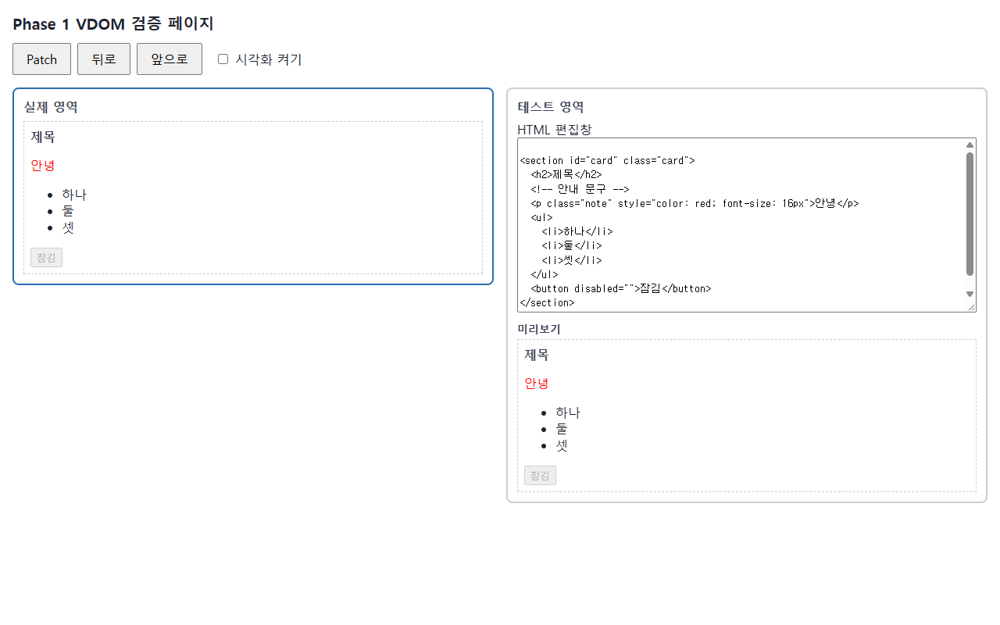 |  |

### 6.2 VNode 구조와 변환 범위

- **요소**: `{ type, props, children, key }`, **글자**: `{ type: '#text', props: { nodeValue }, children: [] }`, **주석**: `{ type: '#comment', … }`
- **공백 · 주석도 노드로 남김** → VNode 자식 번호 = DOM `childNodes` 번호. 그래서 patch 경로(인덱스 배열)로 실제 노드를 바로 찾을 수 있다
- **속성**: 실제 DOM에서 읽은 이름 · 값을 그대로 담음. boolean 속성은 보통 속성(값 `""`)으로 추가 · 삭제, `style`은 항목별로 비교
- **영역 상자**: 실제 영역 · 테스트 영역 상자는 보이지 않는 감싸개라 최상위 노드 여러 개 · 0개도 허용

### 6.3 Diff 알고리즘과 선택 이유

- **위치 기반 (필수)**: 같은 자리 · 같은 태그면 그 자리에서 속성 · 자식을 비교, 태그가 다르면 교체, 남는 쪽은 추가 · 삭제
- **Key 확장 (선택)**: 자식에 key가 있으면 key 표로 짝을 짓고 이동(MOVE). key 없는 자식 · 중복 key는 위치 비교로 돌아감
- **선택 이유**: 필수 범위는 위치 기반이 단순하고 설명하기 쉽다. 목록 순서 바꾸기처럼 위치 비교가 약한 경우만 key 확장으로 보여 준다 ([7.6](#76-이벤트--입력--목록과-key) 화면)
- **결과 표현**: 고칠 일(patch) 목록. 한 줄 = 종류 · 경로 · 전 · 후. 역patch를 만들기 쉬워서 History에 그대로 쓴다

### 6.4 기본 5가지 변경 · 무변경 처리

| PRD 변경 유형 | patch 종류 | DOM에서 하는 일 |
| --- | --- | --- |
| D-01 텍스트 변경 | `SET_TEXT` | 글자 노드의 `nodeValue`만 바꿈 (노드 그대로) |
| D-02 속성 추가 · 수정 · 삭제 | `SET_ATTR` (style은 `SET_STYLE`) | 그 요소의 속성 하나만 바꿈 |
| D-03 노드 추가 | `INSERT` | 목표 위치에 새 노드 삽입 |
| D-04 노드 삭제 | `REMOVE` | 그 노드만 제거 |
| D-05 노드 교체 | `REPLACE` | 태그가 다르면 하위 트리째 교체 |
| 무변경 | (0줄) | DOM을 건드리지 않고 기록도 쌓지 않음 |
| Key 확장 · Phase 2 | `MOVE` · `SET_EVENT` · `SET_PROP` | 노드 이동 · 핸들러 교체 · `value` / `checked` |

### 6.5 DOM 적용 방식

- patch 목록을 **순서대로 하나씩** 적용하고, 경로는 **그 순간의 트리 기준**으로 찾는다. 여러 형제를 지우면서 수정해도 엉뚱한 노드를 고치지 않는다 (T-05)
- 바뀐 노드만 손대고 나머지 노드는 **같은 객체(참조)를 유지**한다 (T-06). 아래 캡처의 주황 상자가 patch가 실제로 손댄 노드다

| 「시각화 켜기」 뒤 [Patch]: `또 만나요` 글자 노드 하나만 깜빡임 (실제 DOM이 아니라 덧칠 층에 그림) |
| --- |
|  |

### 6.6 History 저장 · 복원 정책

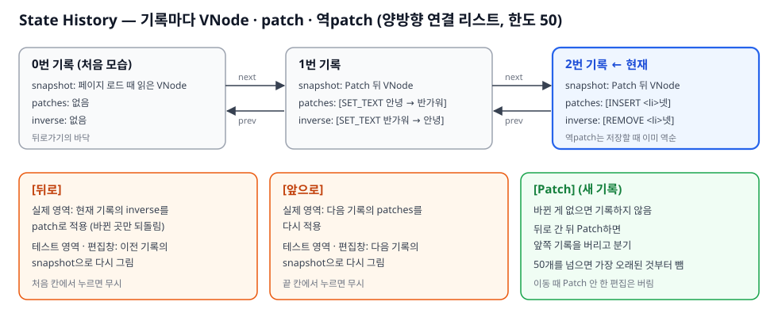

| [뒤로] 누르기 전: Patch 2번(글자 변경 → `<li>넷</li>` 추가) 뒤 | [뒤로] 뒤: `넷`이 사라지고 편집창 · 미리보기 · 실제 영역이 모두 1번 기록으로 |
| --- | --- |
| 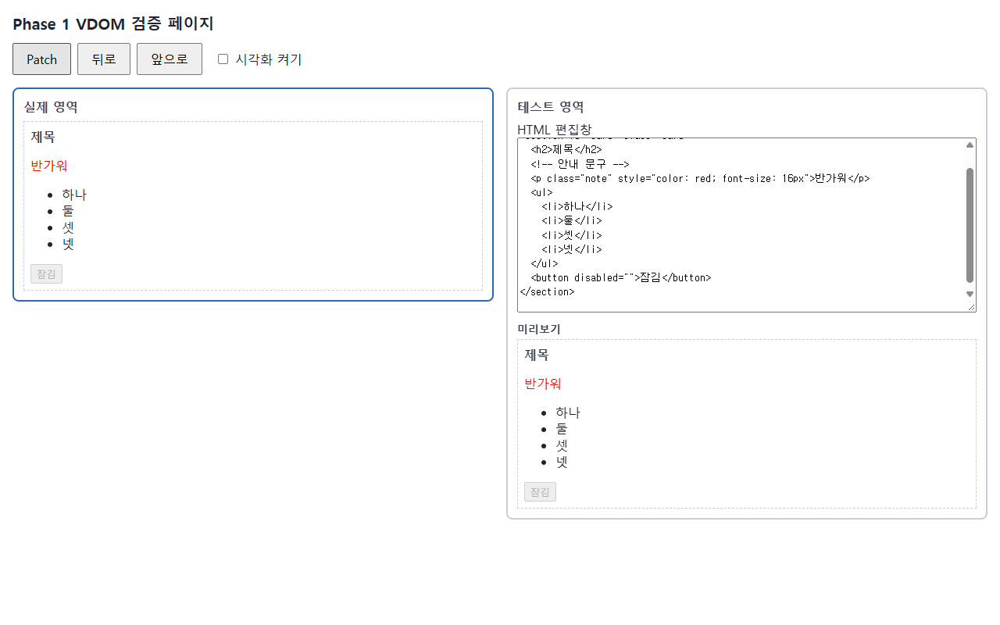 |  |

- **정책**: 처음 모습 = 0번 기록 · 무변경 Patch는 기록 안 함 · 뒤로 간 뒤 새 Patch면 앞쪽 기록 버림 · 처음 · 끝에서 누르면 무시 · 이동 때 Patch 안 한 편집은 버림 · 한도 50
- **과거 기록 보존**: 기록마다 VNode 스냅샷을 따로 저장하고 다시 고치지 않는다 (P1-27)

### 6.7 입력 처리 · 오류 정책

- **실행 가능한 HTML**: `<script>` · `on…` 속성 · `javascript:` · `<iframe>` · `<style>` 등은 미리보기에서 빼고 Patch 때 검사해서 막음
- **잘못된 HTML**: Patch 때 태그 짝 · 구조를 검사해서 문제가 있으면 alert로 막고 실제 영역 · 기록은 그대로 둠
- **patch 도중 예외**: 기록은 그대로 두고, 실제 영역을 마지막 기록 VNode로 다시 그린 뒤 알림
- **SVG**: 지원하지 않음 (Patch 때 막음)

| `</ul>`을 지우고 [Patch] → 「태그 짝」 alert를 닫은 직후: 실제 영역은 그대로 (`하나 둘 셋`) |
| --- |
| 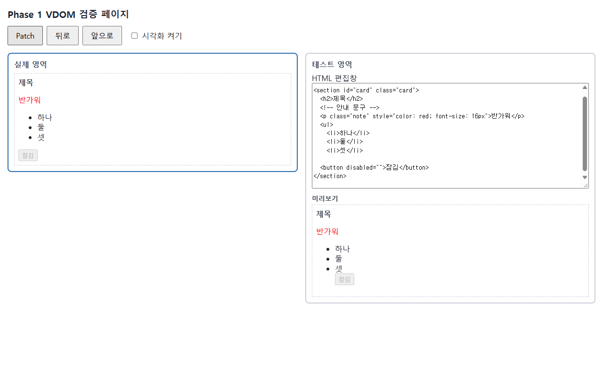 |

## 7. Phase 2 설계 및 렌더링 코어 연계

> 자세히: [wiki/architecture.md 「Phase 2」](wiki/architecture.md#phase-2-functioncomponent--hooks) · [wiki/qna_prep.md 「Hook · 자동 갱신」](wiki/qna_prep.md#hook--자동-갱신-task_002)

### 7.1 Phase 1 코어 재사용 경로

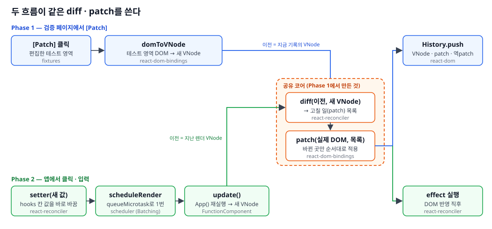

상태 변경이 기존 Diff · Patch에 닿는 실제 코드 경로:

| 순서 | 코드 | 하는 일 |
| --- | --- | --- |
| 1 | [`FunctionComponent.setState`](packages/react-reconciler/src/FunctionComponent.ts#L278) | 칸 값을 바로 바꿈. 같은 값(`Object.is`)이면 여기서 멈춤 |
| 2 | [`scheduleRender`](packages/scheduler/src/scheduler.ts#L54) | `queueMicrotask`로 컴포넌트당 렌더 1번 예약 (Batching) |
| 3 | [`FunctionComponent.update`](packages/react-reconciler/src/FunctionComponent.ts#L84) | `App()` 재실행 → 자식 컴포넌트를 풀어 둔 새 VNode ([`resolveComponents`](packages/react-reconciler/src/resolveComponents.ts#L26)) |
| 4 | [`diff([이전], [새])`](packages/react-reconciler/src/FunctionComponent.ts#L90) | **Phase 1과 같은 [`diff`](packages/react-reconciler/src/diff.ts#L7)** |
| 5 | [`render`의 `apply`](packages/react-dom/src/render.ts#L28) | **Phase 1과 같은 [`patch`](packages/react-dom-bindings/src/client/patch.ts#L20)**로 바뀐 곳만 반영 |
| 6 | `runEffects` | DOM 반영 뒤 effect 실행 |

- Phase 1 [Patch]는 같은 `diff` · `patch`를 [`createVDomRoot.update`](packages/react-dom/src/createVDomRoot.ts#L68)에서 부르고 History에 남긴다. 앱 전체 `innerHTML` 교체는 쓰지 않는다 (P2-19 ~ 21)

### 7.2 FunctionComponent의 hooks · mount() · update()

- `hooks`: 상태 칸 배열. `useState` · `useEffect` · `useMemo`가 부른 순서대로 한 칸씩 씀
- `mount()`: 처음 실행 → VNode → 영역에 한 번 그림 → effect
- `update()`: 다시 실행 → 새 VNode → 이전 VNode와 diff → patch → effect

| 처음 화면: 기록판 렌더 1 · effect 1 · memo 1 · patch 0 (렌더 · Patch 버튼 없음) | [+3] 한 번: setter 3번이지만 **렌더는 1 → 2로 1번만** (Batching) |
| --- | --- |
| 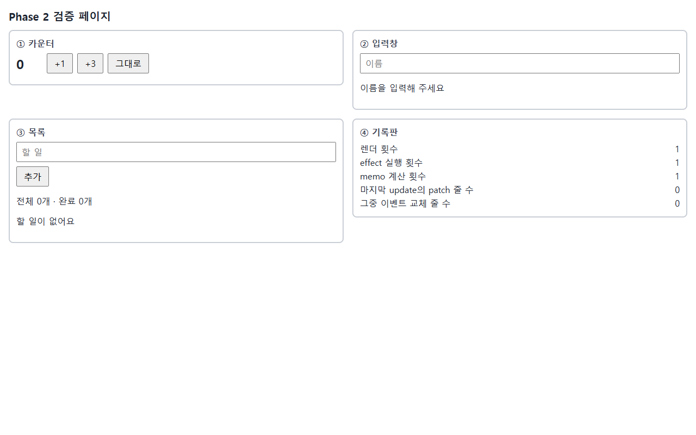 | 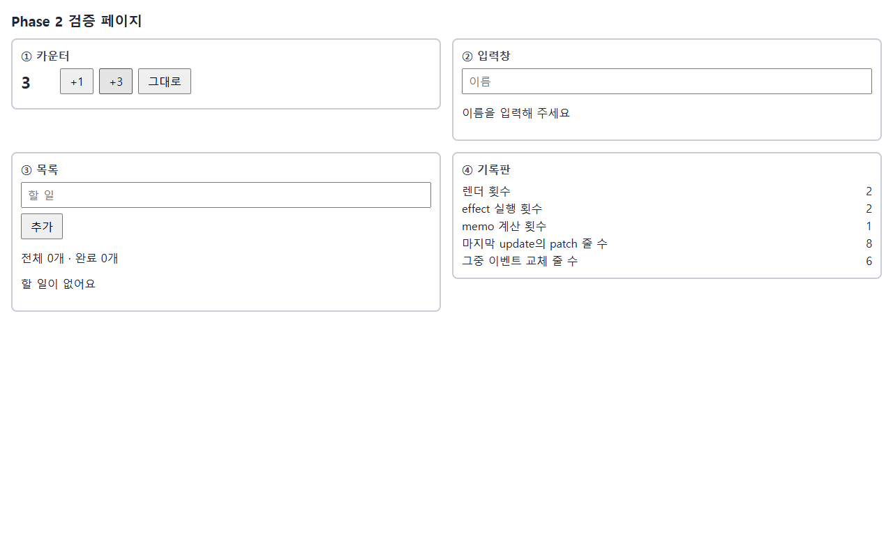 |

### 7.3 상태가 유지되는 원리

- 상태는 함수 안 지역 변수가 아니라 `FunctionComponent` 인스턴스의 `hooks` 배열에 있다
- 렌더마다 0번부터 Hook을 부른 순서대로 같은 칸을 다시 찾는다. 그래서 `if` · `for` 안 Hook은 금지이고, 개수가 달라지면 오류

### 7.4 루트 · 자식 책임

- 루트 `App`만 state · Hook을 갖고, 자식은 props만 받아 VNode를 돌려주는 순수 함수 (P2-07 ~ 10)
- 자식 실행 중 Hook을 부르면 오류. `rootOnlyHooks` 테스트가 코드에서도 확인한다 (T-16)
- 자식은 diff 전에 그 자리에서 실행해 요소로 풀어 둔다. diff · patch는 요소와 글자만 본다
- mini-figma: state는 `App` 하나, `Button`은 `h(Button, { key: it.id, ...main, ...it })`로 그린다 ([1절 화면](#1-프로젝트-소개와-사용법)의 메인 색 변경이 이 경로)

### 7.5 Hook 동작 정책

| Hook | 정책 |
| --- | --- |
| `useState` | 같은 값(`Object.is`) setter는 다시 그리지 않음 · 함수형 setter · 지연 초기화 · 렌더 중 setter는 오류 |
| `useEffect` | patch 직후 실행 · 의존성 생략 = 매 렌더 / `[]` = 처음 한 번 / 항목별 `Object.is` 비교(길이가 다르면 변경) · cleanup은 다시 실행 직전과 `unmount()` 때 |
| `useMemo` | 같은 의존성이면 재사용, 생략하면 매 렌더 재계산 |
| 안전장치 | effect → setter → 렌더가 50번 넘게 이어지면 오류 · 렌더가 실패하면 슬롯 · memo · effect 예약을 되돌림 |

### 7.6 이벤트 · 입력 · 목록과 key

- **이벤트**: `onClick` · `onInput` props → 요소마다 이벤트 이름당 리스너 한 번만 등록, 다시 렌더할 때는 핸들러만 교체 (중복 실행 없음)
- **입력**: `value` · `checked`는 프로퍼티로, 실제 값과 다를 때만 넣음. 입력창은 다시 만들지 않고 그 자리에서 고쳐서 포커스 · 커서 유지
- **목록**: 항목 id를 key로 써서 순서를 바꿔도 같은 노드를 옮김 (MOVE)

| 이름 입력 중: 매 글자마다 재렌더되지만 입력창 포커스 유지 | 할 일 `귤` [위로]: 순서 `사과` `귤` `배`, `사과` 체크 상태 유지 (key 이동) |
| --- | --- |
| 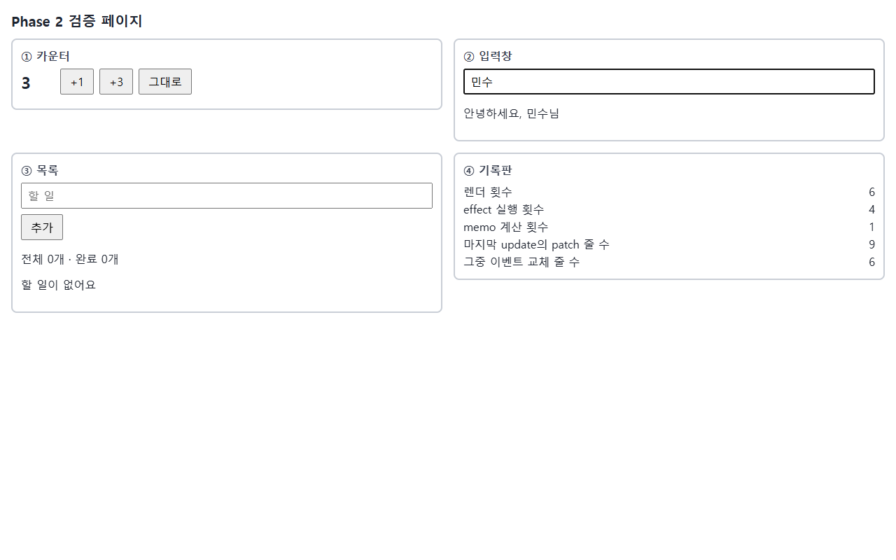 |  |

### 7.7 개인 앱에서도 같은 Phase 1 흐름

mini-figma의 [Patch]는 캔버스(테스트 영역) DOM을 `readAreaChildren`으로 읽어 `createVDomRoot(실제 영역).update`에 넘긴다. Phase 1 검증 페이지와 같은 diff · patch · History다.

| [Patch] 전: 메인 색을 빨강으로 바꾼 테스트 영역 | [Patch] 직후: 실제 영역에서 바뀐 메인 · b1 · b2만 깜빡임 (이미 빨강이던 b3는 그대로) |
| --- | --- |
| 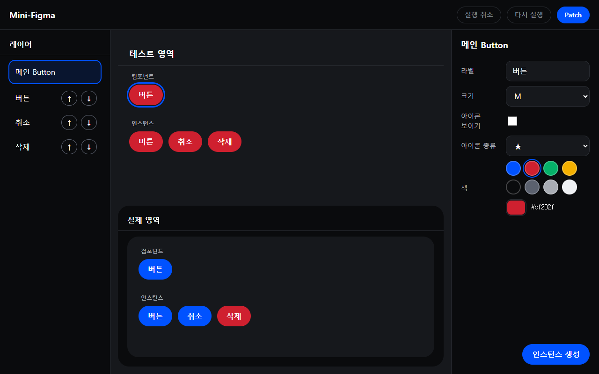 |  |

## 8. 테스트 및 측정 결과

> 자세히: [wiki/architecture.md 「검증 결과」](wiki/architecture.md#검증-결과) · 측정: [docs/공통_측정_지표_결과.md](docs/공통_측정_지표_결과.md)

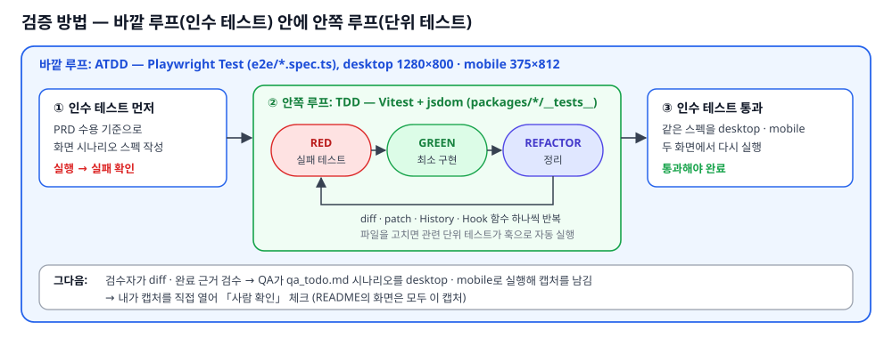

### 8.1 모듈별 테스트

| 모듈 | 단위 테스트 (Vitest + jsdom) | 화면 기능 테스트 (Playwright) |
| --- | --- | --- |
| DOM 변환 · 렌더링 · Patch | `react-dom-bindings/…/__tests__/` `domToVNode` · `renderVNode` · `patch` · `style` · `domProps` · `events` · `checkHtml` · `sanitize` | `phase1-render` · `phase1-patch` · `phase1-roundtrip` · `phase1-guard` · `phase1-attack` |
| Diff · 역patch | `react-reconciler` `diff` · `diffProps` · `diffKeyed` · `diffEvents` · `invertPatches`, `react-dom` `diffPatchKeyed` | `phase1-patch` · `phase1-visual` |
| History | `react-dom` `history` · `createVDomRoot` | `phase1-history` |
| Component · Hooks | `react-reconciler` `functionComponent` · `useState` · `useEffect` · `useMemo` · `hookErrors` · `resolveComponents` · `deps`, `react` `h` · `hooks` | `phase2-render` · `phase2-counter` · `phase2-input` · `phase2-todo` · `phase2-log` · `phase2-attack` |
| 렌더 예약 | `scheduler` | `phase2-batching` |
| 개인 앱 | `fixtures/mini-figma/__tests__/` 11개 (`rootOnlyHooks` 포함) | `mini-figma-*` 11개 |
| 측정 | `fixtures/perf-bench/__tests__/` 4개 | `phase2-perfbench` |

### 8.2 주요 경계 사례

무변경 Patch · 여러 형제 삭제 + 수정 동시 · 공백 · 주석 노드 · 같은 값 setter · 같은 틱 setter 여러 번(렌더 1번) · 이력 처음 · 끝 · 분기 · 한도 50 · 입력창 포커스 유지 · 위험 HTML 차단 · patch 도중 예외 복구

### 8.3 실제 실행 결과 (2026-11-12 재실행)

| 명령 | 결과 |
| --- | --- |
| `npx vitest run` | 47 files · **1251 passed** |
| `npx playwright test` | **378 passed** (desktop 189 · mobile 189) |
| `npx tsc --noEmit` | 오류 0 |

QA 단계 실패 0건 (task_001 ~ 007). 각 task의 QA 캡처는 내가 직접 열어 「사람 확인」에 체크했다.

### 8.4 부분 갱신 근거

- **노드 참조 유지 단언**: 텍스트 · 속성만 바뀔 때 다른 노드가 같은 객체인지 `toBe`로 확인 ([`patch.test.ts` 「참조 유지」](packages/react-dom-bindings/src/client/__tests__/patch.test.ts#L220), e2e QA-2 · QA-9)
- **측정 대시보드**: B-01 ~ B-06에서 노드 507개 중 507개 유지 (M-03)
- **patch 줄 수와 MutationObserver 기록 비교**: 텍스트 하나 변경 = patch 1줄 · 관찰 기록 1개, 무변경 = 0 · 0

### 8.5 측정 결과

성능 대시보드(`/perf-bench/`), Playwright 헤드리스 Chromium 158 · Windows · 1280×800 · Vite dev 서버, 준비 5회 + 측정 30회, p50 / p95, 2026-11-11에 한 번 잰 값. 공통 fixture = 항목 100개(DOM 노드 507개, 깊이 5)

| 시나리오 | 전체 처리 M-07 (p50 / p95) | patch 줄 M-02 | MutationObserver 기록 |
| --- | --- | --- | --- |
| B-01 변경 없음 | 0.400 / 0.810 ms | 0 | 0 |
| B-02 텍스트 하나 변경 | 0.300 / 0.600 ms | 1 | 1 |
| B-03 속성 하나 변경 | (기록 없음) | 1 | 1 |
| B-04 자식 하나 추가 · 삭제 | (기록 없음) | 2 | 2 |
| B-05 여러 위치 동시 변경 | 0.300 / 0.800 ms | 5 | 5 |
| B-06 setter 10번 연달아 — 즉시 동기 → Batching | 2.700 / 3.210 → **0.300 / 0.830 ms** | 10 → **1** | 10 → — |
| B-07 개인 앱 대표 동작 (Batching) | 1.200 / 1.955 ms | 167 (그중 `SET_EVENT` 126, DOM 작업 없음) | — |

| 측정 화면: B-01 ~ B-07 결과 표, B-06 비고 `setter 10번 → 렌더 1번` |
| --- |
| 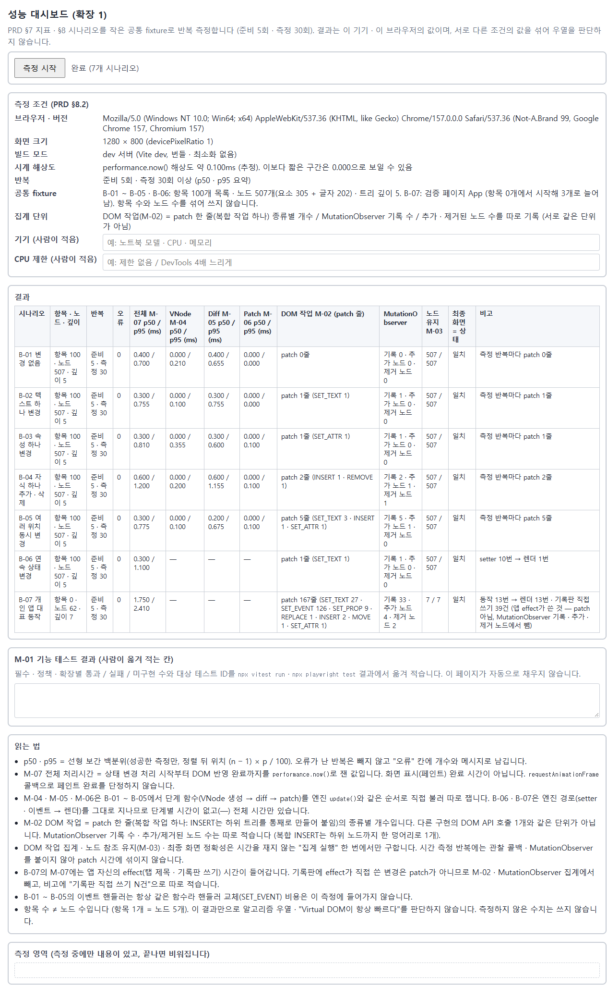 |

### 8.6 검증의 한계

- **측정**: 한 번 잰 값이고 실행마다 값이 달랐다. 시간은 DOM 반영까지라 reflow · repaint는 들어 있지 않다. B-03 · B-04 시간은 기록 파일에 옮기지 않아 적지 않았다. "VDOM이 항상 빠르다"를 전제하지 않는다
- **확인하지 않은 것**: Key 확장의 화면 시연은 Phase 2 목록뿐이고 Phase 1 화면에는 key가 없다(단위 테스트로 검증, 이동 횟수 최소는 아님) · 테스트 크기(1280×800 · 375×812) 밖 화면 · Chromium 외 브라우저 · 번들 빌드

## 9. 지원 범위와 한계

> 자세히: [wiki/architecture.md 「알려진 한계」 · 「실제 React와 차이」](wiki/architecture.md#알려진-한계) · 정책 전체: [CLAUDE.md 「정책」](CLAUDE.md)

- **지원하지 않는 것**: SVG, `click` · `input` 외 이벤트(끌기 · 크기 조절 없음), DOM 프로퍼티는 `value` · `checked`만, 자식 컴포넌트의 독립 state
- **알려진 문제**
  - 공백 · 주석을 노드로 남겨 들여쓰기만 바꿔도 글자 patch가 생김
  - 렌더마다 핸들러가 새 함수라 이벤트 교체 patch 줄이 늘 생김 (DOM 작업은 없음)
  - `<select value>` + `<option>` 삭제를 한 기록에서 함께 한 뒤 뒤로 가면 선택값이 다를 수 있음 (드묾)
  - mini-figma: 처음 · 끝 기록 칸에서 Patch 안 한 편집은 버튼이 꺼져 버릴 수 없음, 낮은 desktop 높이(예 721×300)에서 패널 일부가 잘림
- **실제 React와 주요 차이**

| 항목 | 내 미니 React | 실제 React |
| --- | --- | --- |
| 변경 적용 | 고칠 일 목록을 만들어 순서대로 적용 | 노드마다 표시(flag)를 남김 |
| History | 엔진에 내장 (patch · 역patch) | 없음 |
| 재렌더 | `queueMicrotask` Batching 한 가지 | 우선순위 · 시간 분할 · Fiber |
| 컴포넌트 | State · Hook은 루트에만 | 모든 컴포넌트가 자기 state |

---

## 부록 A. 개발 방식 — AI 에이전트 워크플로

> 플러그인 `mini-react-kit`(개인용)의 `/mini-react-kit:agent-workflow`. 기록: `.agent_workflow/tasks/<task>/`

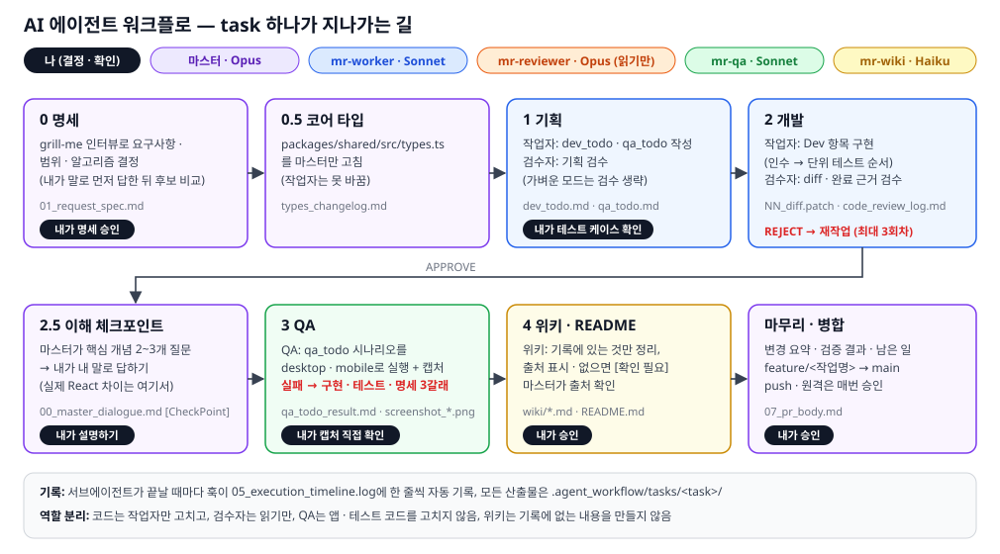

- **역할 분리**: 메인 세션(마스터)은 나와 대화하고 단계를 넘긴다. 코드는 작업자만 고치고, 검수자는 읽기만 하고, QA는 앱 · 테스트 코드를 고치지 않는다
- **내가 하는 일**: 알고리즘 결정 · 명세 승인 · 테스트 케이스 확인 · 이해 체크포인트에서 내 말로 설명 · 캡처 직접 확인 · 병합 승인
- **진행 모드**: 기본(검수 회차마다) / 가벼운(마감이 급할 때 기획 검수 생략, 테스트 케이스 확인은 필수)
- **QA 실패 3갈래**: 구현 결함 → 작업자 수정 · 경량 검수 / 테스트 결함 → `e2e/` · `qa_todo.md`만 수정 / 명세 결함 → 1단계로 롤백

<!-- mini-react-kit:readme:start -->
<!-- 이 표시 사이는 4단계에서 mr-wiki가 갱신한다. 표시 밖은 건드리지 않는다 -->

## 부록 B. AI 워크플로 운영 결과

| 항목 | 값 |
| --- | --- |
| task | 7개 (Phase 1 · Phase 2 · Batching · mini-figma · 디자인 · 실제 영역 · 변수) |
| QA 실패 분류 (구현 · 테스트 · 명세) | QA 실패 0건 (task_001 ~ 007). 개발 검수 BLOCKING은 모두 작업자 재작업으로 해결 |
| 자동 테스트 (최종) | vitest 1251 · playwright 378 · tsc 오류 0 |

- 워크플로 기록: `.agent_workflow/tasks/` · 위키: [wiki/index.md](wiki/index.md)

<!-- mini-react-kit:readme:end -->
